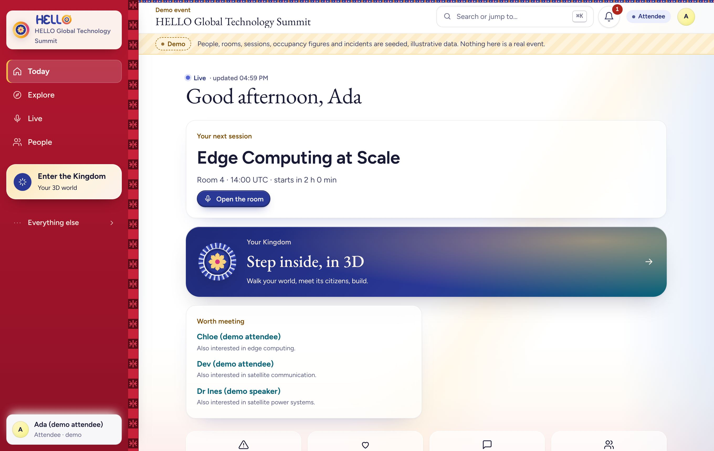
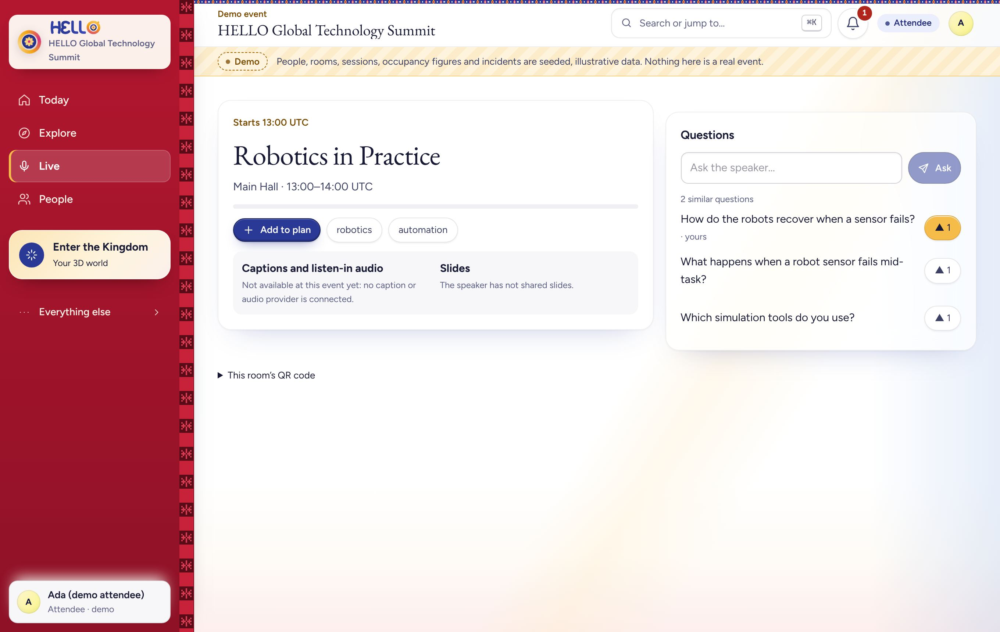
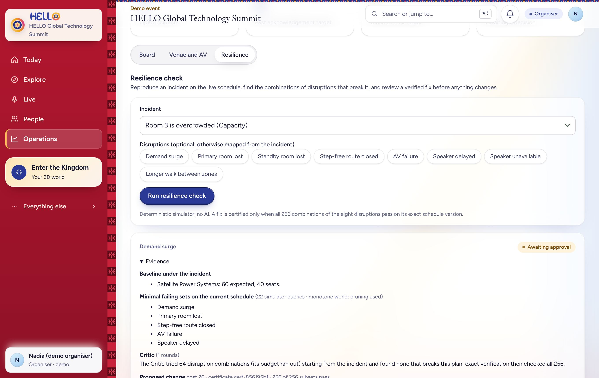
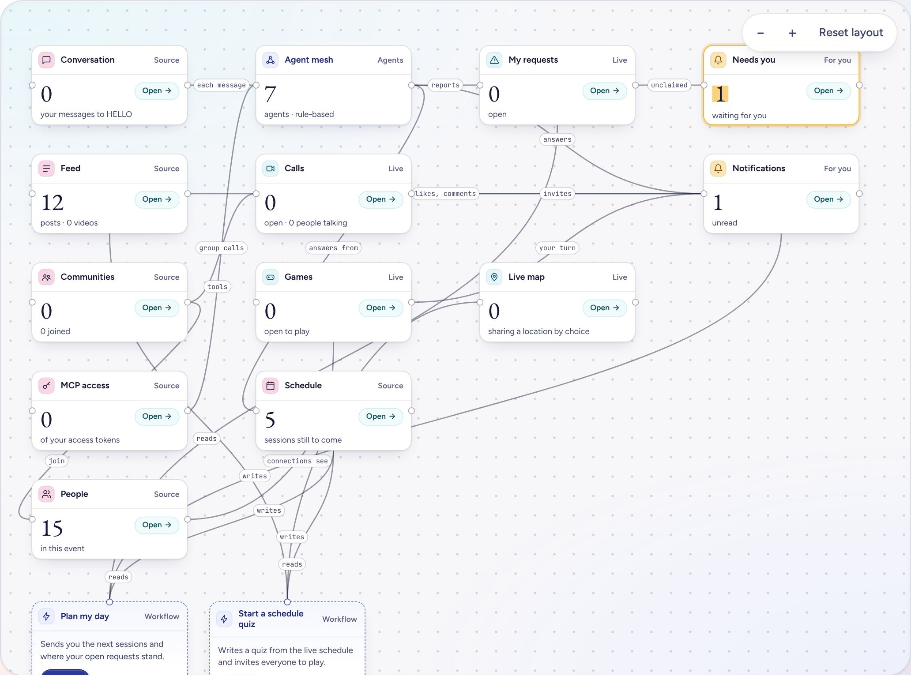

# HELLO — your event, in one place



HELLO is an event companion and operations system for technology conferences, hackathons and multi-track
gatherings, built on the Nexconn chat SDKs. It has two connected sides that share **one event model** (the same
event, rooms, sessions, people and incidents):

- **For attendees**: what is on, what to see, who to meet, the live session room, a Plan B with a held seat
  when a room is full, and a one-tap "I need a break" that works offline.
- **For the team**: incidents and AV signals, rooms and seats, approvals, and **Steadfast**, which proves a
  schedule change survives every combination of eight disruptions before an organiser approves it.

The experience is minimal; the depth is underneath.

> **Status: a working, tested prototype, not a production system.** Everything marked *verified* below has
> tests and was driven in a real browser. Captions/audio, a live Nexconn token (it needs the App Secret), the graph-based networking
> layer and the official-schedule reconciler are not done; the [status table](#status) says exactly what is.

**Contents:** [Quick start](#quick-start) · [Five destinations](#five-destinations) · [Architecture](#architecture) ·
[Live sessions](#live-sessions) · [Plan B](#plan-b-and-seat-holds) · [Steadfast](#steadfast) · [Nexconn](#nexconn) ·
[Security](#security-and-privacy) · [Setup](#setup) · [Tests](#tests) · [Status](#status)

## Quick start

```bash
npm install
cp .env.example .env.local      # HELLO_DEMO_MODE=true
npm run dev                     # http://localhost:3000
```

Open the site and press **Enter HELLO**. That is all: you are a demo attendee. To see another side, choose
*Speaking* or *On the team* under the button before entering, or open *Someone specific* to pick any of the
sixteen seeded, fictional people. Every person, room, session and figure in the demo is illustrative data.

## Five destinations

| Destination | What it is for |
|---|---|
| **Today** | What matters now: your next session (or picks to start a plan), a Plan B when it is full, schedule changes, later today, people worth meeting, and quick help: report a problem, I need a break, ask for help, my connections. A door into your **3D Kingdom** sits here and in the sidebar. |
| **Explore** | One search for sessions, people, rooms, topics and guides; the programme with *Add to plan*; topics; every other tool in HELLO. |
| **Live** | Rooms running now and next. A session's live room: timeline, questions grouped by similarity, *Can't hear* / *Can't see*, and the room's QR code. |
| **People** | The directory, follows and profiles. |
| **Operations** (staff) | Board (incidents and their targets), Venue and AV (seats, Plan B holds, AV signals, *Mark full*), Resilience (Steadfast). |

Nothing was removed: Moments, Ask HELLO, private messages, the schedule, the venue map (2D, 3D, heat, floors),
announcements, communities, Kingdom and its map, calls, games (now with **Create a game**), Field Atlas, the
workflow canvas, the privacy filter and more are under **Everything else**, in the command palette (⌘K) and in
the phone menu. Their details are in [docs/FEATURE_REFERENCE.md](docs/FEATURE_REFERENCE.md).

| Live room | Steadfast approval card | Workflow canvas |
|---|---|---|
|  |  |  |

## Architecture

```
 Browser: Today · Explore · Live · People · Operations      Nexconn Chat SDK · Chat UI · Call SDK
   (client islands; offline worker caches /care only)          (App Key + server-issued token)
            │ /api/events/:id/** (Zod)  ▲ SSE nudges                        │
            ▼                           │                                   ▼
 ┌─────────────────────────────── Next.js server ───────────────────────────────────────┐
 │ Routes ─► Services: the only layer that decides (requireCapability on every call)     │
 │   live-room  plan · AV signals · questions · seat holds · Plan B · care · venue board │
 │   resilience Steadfast check · approval gate · execution · targeted notifications      │
 │   incidents · approvals · workflows · games · people · search · moments · …           │
 │        ▼                                                                              │
 │ Pure domain (no storage, clock or AI): companion/ · resilience/ · venue/ · incidents/ │
 │        ▼                                                                              │
 │ HelloStore ── Postgres (DATABASE_URL) │ memory (+ disk with HELLO_DATA_DIR)           │
 │ Live layer: every write → content-free nudge, only to the people concerned            │
 │ Chat gateway: signed webhook bridge + delivery outbox for Nexconn                     │
 └──────────────────────────────────────────────────────────────────────────────────────┘
```

Every module uses the event's own ids: Steadfast builds its world from the live rooms and sessions, Plan B ranks
the same sessions, AV signals file ordinary incidents. Capacity and one-shot decisions are conditional writes
(a row lock on Postgres), so concurrent requests cannot over-allocate seats or approve twice.
More: [docs/HELLO_ARCHITECTURE.md](docs/HELLO_ARCHITECTURE.md), [docs/architecture.md](docs/architecture.md).

**Postgres** is the source of truth. **A graph database is not used yet**: the planned FalkorDB/Neo4j projection
for networking intelligence is designed in [docs/HELLO_EVENT_GRAPH.md](docs/HELLO_EVENT_GRAPH.md) but not built.

## Live sessions

- **Can't hear / Can't see** count each person once. Three distinct people within 60 seconds raise **one** AV
  incident through the normal incident pipeline; later reports attach to it. Staff see the counts on the venue
  board; reporters are asked *Better now?* after the repair.
- **Questions** are grouped by similarity, voted on, and never show other attendees who asked.
- **Captions, listen-in audio and slides need a media provider, which is not connected.** The room says so
  instead of showing anything invented. ([docs/HELLO_LIVE_SESSIONS.md](docs/HELLO_LIVE_SESSIONS.md))

## Plan B and seat holds

When a planned session is full, HELLO ranks the sessions you can still reach: hard filters first (free seats,
step-free if you asked, no clash with your plan, reachable in time), then topic, start time, seats and walking
time over the real venue graph, each option with its reasons. **Hold my seat** checks and reserves in one
conditional write and lasts 10 minutes; in the tests, 10 people racing for 3 seats get exactly 3. Staff can mark
a room full; its door QR sends each person to their own Plan B. ([docs/HELLO_SCHEDULER.md](docs/HELLO_SCHEDULER.md))

## Steadfast

A deterministic simulator `s' = F(s, Δ)` checks a schedule against every subset of eight disruptions (2⁸ = 256):
demand surge, primary room loss, standby room loss, step-free route closure, AV failure, speaker delay, speaker
unavailable, longer walks between zones. In Operations → Resilience, a supervisor picks an incident; HELLO
reproduces it, finds the minimal failing disruption sets, proposes a fix, lets an adversarial **Critic** attack it
(a claim counts only with a simulator witness), **verifies all 256 subsets** on the exact schedule version, shows
cheaper rejected fixes with the disruption that breaks each, and **stops at an approval card**. Only an
organiser can approve; a stale proposal is refused; after approval, only the speakers, attendees with the
session planned or held, and staff are told. No AI is involved. Benchmark over 41 worlds and every limitation:
[docs/HELLO_STEADFAST.md](docs/HELLO_STEADFAST.md).

## Nexconn

All three packages are installed and share one engine: `@nexconn/chat` (Chat SDK: messages, channels,
presence), `@nexconn/chatui` (ready-made chat screens) and `@nexconn/call` (voice and video). The Call SDK pins
its peers to 26.2.0; `package.json` overrides that to the installed 26.5 chat and engine, which needs a runtime
check once credentials exist. The official Nexconn agent skill is vendored at `.claude/skills/nexconn-chat`.

- `NEXCONN_APP_KEY` (may reach the browser) and `NEXCONN_APP_SECRET` (**server only**) come from the Nexconn Console.
- `POST /api/nexconn/token` issues a token for the signed-in person; the browser connects with
  `connectNexconn()` (`src/integrations/nexconn/client.ts`, API verified against the installed type definitions).
- The token call is written from Nexconn's Platform Chat API docs: `SHA1(AppSecret + Nonce + Timestamp)` signs a
  `POST /v4/auth/access-token/issue` to the app's data centre (`NEXCONN_AREA`, default `SG`:
  `api.sg-light-api.com`, then `api-b.sg-light-api.com` after a timeout or server error). Nexconn user ids are
  letters and digits derived from the HELLO id, never the id itself. Verified against Nexconn: the Singapore hosts
  answer and reject a wrong signature with `401 / 1004`; a successful issue waits for `NEXCONN_APP_SECRET`.
  A test fails if any browser file reads the App Secret. Messaging also works today through the tested chat gateway: [docs/nexconn-integration.md](docs/nexconn-integration.md).

## Security and privacy

Authorisation is decided on the server for every request; hiding a control is never the boundary. Plans,
AV signals and questions are personal and covered by export and erasure. Only organisers approve schedule
changes, and only through a signed-in session (not an access token or an agent). The offline worker caches only
the care page. Full table: [docs/HELLO_PRIVACY_SECURITY.md](docs/HELLO_PRIVACY_SECURITY.md); earlier audits:
[docs/security.md](docs/security.md), [docs/security-audit.md](docs/security-audit.md).

## Setup

Requirements: Node.js 20.9+ (tested with 22), npm 10. PostgreSQL 15+ for durable storage.

| Variable | Purpose |
|---|---|
| `HELLO_DEMO_MODE` | `true` seeds the demo event and enables *Enter HELLO* |
| `DATABASE_URL`, `HELLO_DB_SCHEMA` | Postgres store; the schema is created on first start. Without it, an in-memory store |
| `HELLO_DATA_DIR` | Saves the in-memory store to disk |
| `NEXCONN_APP_KEY`, `NEXCONN_APP_SECRET` | Nexconn credentials (secret on the server only) |
| `HELLO_CHAT_SECRET`, `HELLO_CHAT_OUTBOUND_URL` | Signed chat gateway bridge |

The full list with comments is in [.env.example](.env.example). **Migrations**: the app's tables, including the
document table that holds every new collection (`plans`, `avSignals`, `liveQuestions`, `seatLedgers`,
`scheduleProposals`), are created by `src/store/postgres.ts` on start; no manual migration is needed. The separate
Supabase design is in `supabase/migrations` ([docs/database.md](docs/database.md)).

**Deployment**: `npm run build` then `npm start`, with `DATABASE_URL` set for more than one instance. Rate
limits are per instance. Demo sign-in is not authentication: do not run a real event in demo mode.
([docs/deployment.md](docs/deployment.md))

**External services**, none required for the demo: Nexconn (credentials + token API), a caption/audio media
provider (not chosen), an AI provider (none; every intelligent feature here is deterministic), Tavily for web
research (optional).

## Tests

```bash
npm run check        # typecheck, lint, unit + integration tests, production build
npm test             # vitest: 63 files, 663 tests
npm run test:postgres   # the integration suite on Postgres (HELLO_TEST_DATABASE_URL)
npx vitest run tests/resilience/benchmark.test.ts   # Steadfast benchmark table
# browser journeys, against a production demo server (HELLO_DEMO_MODE=true npx next start -p 3000):
node tests/e2e/companion-flow.mjs   # entry, five destinations, canvas, live room, Plan B, Steadfast, offline care, create a game
npm run test:e2e     # every journey;  npm run test:routes  crawls every page as every role
```

Each browser suite resets the demo first. Evidence for this pass: [docs/TEST_EVIDENCE.md](docs/TEST_EVIDENCE.md).

## Status

| | Area |
|---|---|
| **Verified and working** | One-button entry; five-destination navigation and phone tab bar; Today; Explore; Live hub and live room (questions, can't hear/see → one AV incident, Better now?); personal plan; Plan B with atomic seat holds and room-full QR; venue and AV board; Steadfast end to end with approval and targeted notifications; care page offline (production build); Create a game; workflow canvas fully connected and painted; all earlier features listed in [docs/FEATURE_REFERENCE.md](docs/FEATURE_REFERENCE.md) |
| **Implemented, externally blocked** | Nexconn token issuance (signed call written and tested against Nexconn's hosts; a real token needs `NEXCONN_APP_SECRET`); Nexconn Call SDK at runtime (peer override untested without credentials); captions, listen-in audio and slides (no media provider) |
| **Partial** | Schedule reconciliation: approved changes reconcile plans and notify; the two-minute official-feed reconciler (Grace Period) is not built. People worth meeting: declared interests and planned speakers only |
| **Planned** | Graph database and Kairos (ranking, relationship memory, follow-ups, cross-event recall, contact QR), speed networking, sponsor offers, jargon coach and recap, post-talk report ([docs/HELLO_IMPLEMENTATION_ROADMAP.md](docs/HELLO_IMPLEMENTATION_ROADMAP.md)) |
| **Demo-only** | Demo sign-in; seeded people, venue, occupancy and incidents; the Steadfast v1 benchmark world and its 40 seeded variations |

Known limitations: an approved multi-session change is applied session by session (the approval itself is
decided once); rate limits are per instance; private messages have no forward secrecy; visual regression,
accessibility audit and load tests are not done.

## Licence

No licence has been chosen for this repository yet. The privacy filter is AGPL-3.0 (see
[docs/UPSTREAM_INTEGRATION_AUDIT.md](docs/UPSTREAM_INTEGRATION_AUDIT.md)); the vendored Nexconn skill is
Apache-2.0; Nexconn SDK packages are distributed under their own licences.
