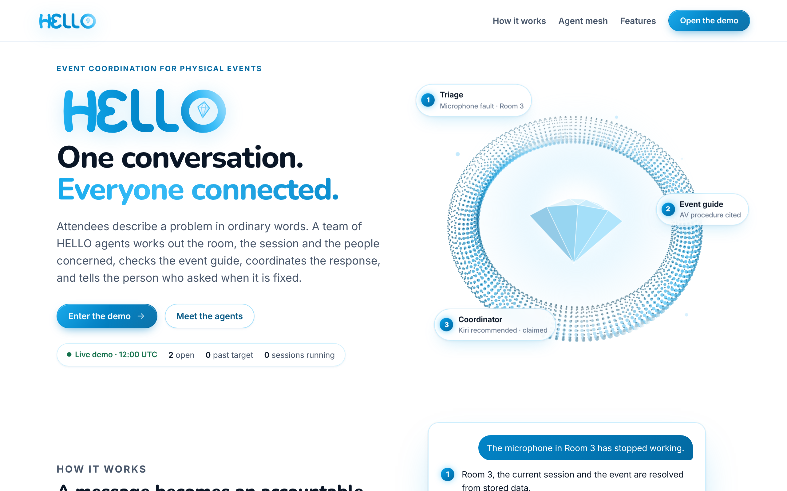
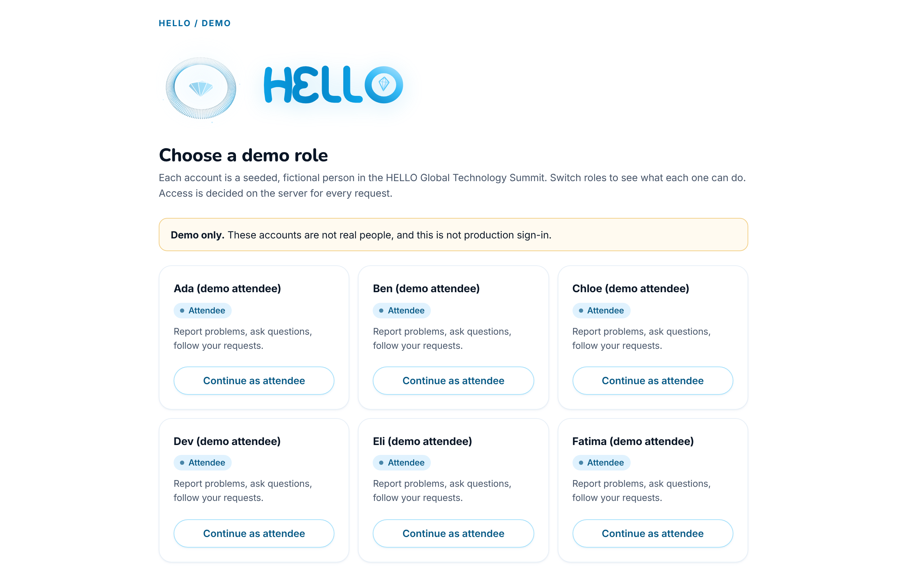
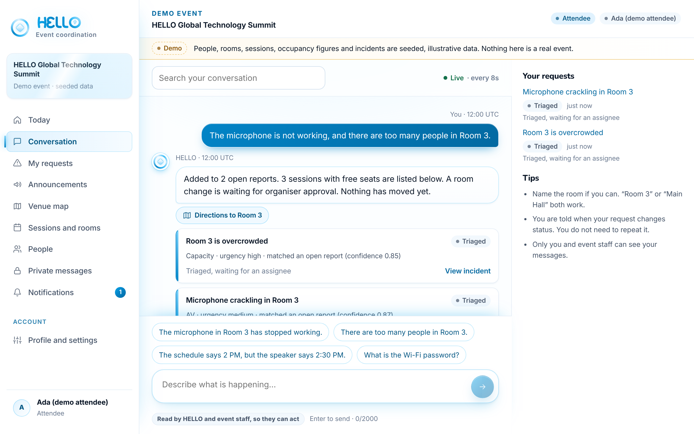
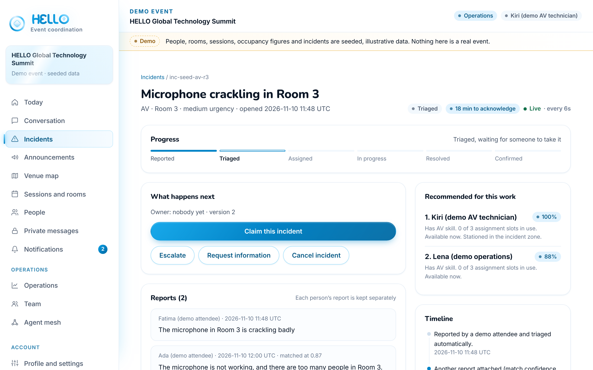
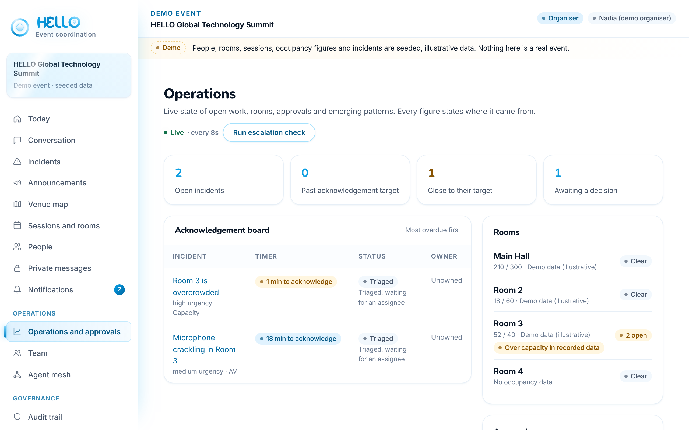
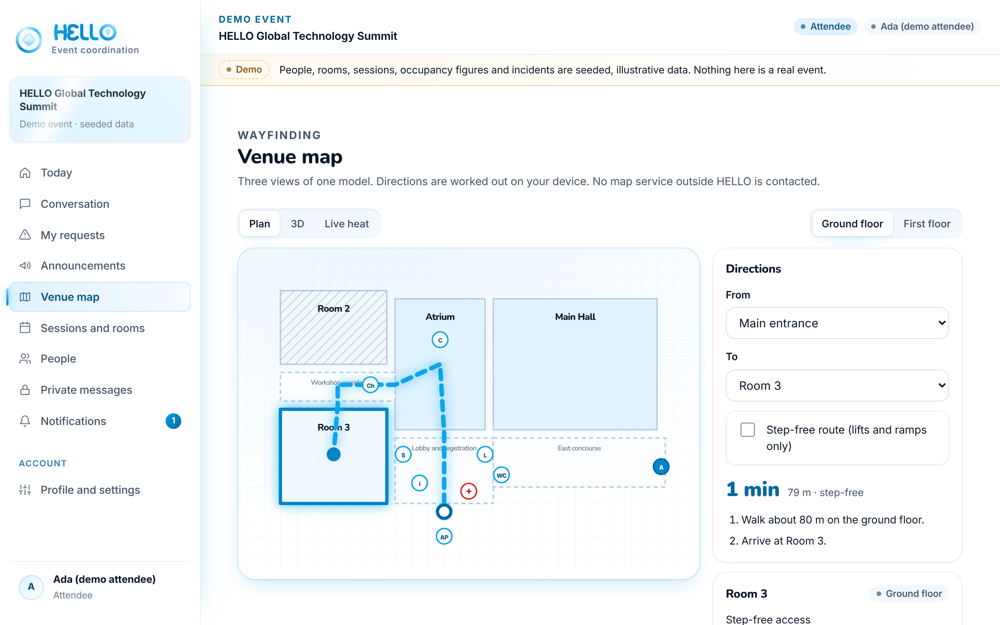
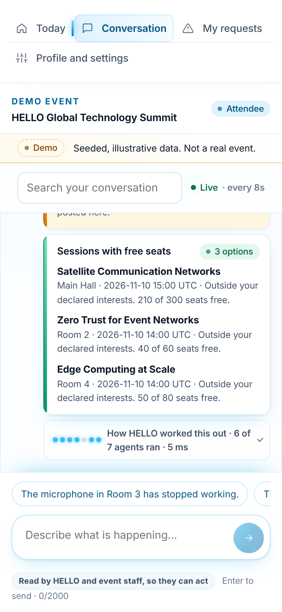

# HELLO — One conversation. Everyone connected.



HELLO is an AI-assisted coordination layer for physical events. An attendee describes a problem in
ordinary words ("The microphone in Room 3 has stopped working."). HELLO works out the room, session and
team concerned, checks whether someone already reported it, routes it to staff with the right skill,
keeps a record of every step, and asks the reporter to confirm when it is fixed.

> **Status: working prototype, not a production system.** The domain logic, workflows and UI are
> implemented and tested. Persistence is an in-memory demo store, messaging is not connected to Nexconn,
> and sign-in is a demo shortcut. See [Status](#status) before using this for a real event.

**Contents:** [Quick start](#quick-start) · [Screenshots](#screenshots) · [What it does](#what-it-does-implemented) ·
[Agent mesh](#agent-mesh) · [Architecture](#architecture) · [Demo walkthrough](#demo-walkthrough-judge-scenario) ·
[Commands](#commands) · [Status](#status)

## Quick start

```bash
npm install
cp .env.example .env.local
npm run dev
```

Open <http://localhost:3000>, choose **Enter the demo**, and pick a demo role. Every person, room and incident
in the demo is seeded, illustrative data. Full instructions are under [Installation and local run](#installation-and-local-run).

## Screenshots

All images are captured from the running demo by `npm run screenshots` (see [Commands](#commands)), so they show
the real interface, not mock-ups.

| | |
|---|---|
|  |  |
| **Demo sign-in.** Each seeded role (attendee, speaker, volunteer, operations, organiser) sees a different HELLO. Access is decided on the server for every request. | **Conversation.** "The microphone is not working, and there are too many people in Room 3." becomes two concerns, each attached to an existing incident with its match confidence. Free sessions are offered, and the room change waits for an organiser. |
|  |  |
| **Incident (staff view).** The workflow rail, the acknowledgement timer, every person's report kept separately, and staff ranked by skill, load, availability and location, with reasons. | **Operations (organiser view).** Live counts, the acknowledgement board (most overdue first), rooms with occupancy and where each figure comes from, approvals and signal review. |
|  |  |
| **Venue map.** Plan, 3D and live-heat views of one venue model. Directions are computed on the device, with a step-free option. | **Phone.** The same conversation at 390 px wide. The navigation becomes scrolling strips and the composer stays on screen. |

## The problem

Physical events run on disconnected channels: informal messages, several inboxes, volunteers who don't know
what is already being handled, technicians who receive half a description, and attendees who never learn
whether anyone is acting. HELLO's premise is that every important conversation should be able to become an
accountable workflow.

## What it does (implemented)

- **One conversation for every role.** Attendees, speakers, volunteers, operations and organisers use the
  same entry point. What they can see and do depends on their membership.
- **Incident intelligence.** Messages become incidents. A report matching an open incident (same room,
  category, within 30 minutes) is attached to it, with its match confidence and signals. Each person's
  report is kept. Reports are never merged on wording alone.
- **Lifecycle.** REPORTED → TRIAGED → ASSIGNED → ACKNOWLEDGED → IN_PROGRESS → RESOLVED → CONFIRMED → CLOSED,
  plus REOPENED, CANCELLED, NEEDS_INFORMATION and ESCALATED. Moves are checked on the server against the
  state machine and against who is making the move.
- **Assignment.** Eligible staff are ranked by skill, workload, availability and location. Each score
  shows its reasons. Claims are version-checked, so two simultaneous claims cannot both succeed.
- **Capacity-aware alternatives.** Sessions that are full, ended, inaccessible (when required) or clash with
  the person's schedule are excluded. Remaining sessions are scored with configurable weights and explained.
- **Approvals.** A consequential change (moving a session to another room) is requested by HELLO only when
  over-capacity is recorded and two or more independent people report it. An organiser must approve it.
  Approval and execution are recorded separately, so an approved move can still fail, and the UI says so.
- **Signal intelligence.** Three or more independent reporters of the same category in one room within ten
  minutes produce a suggested insight. It is built only from stored reports, counts each person once, and
  waits for an organiser's review. Review decisions are not overwritten by later recomputation.
- **People discovery.** Search by declared interest. Only people who opted in appear, the matched interest is shown,
  and no contact details are exposed.
- **Operations view.** Rooms with occupancy and its data source, open incidents, the approval queue and signal review.
- **Honest data labels.** Every occupancy figure states whether it is live verified, administrator entered,
  attendee reported, or demo data.

## Why HELLO, and what it solves that other event apps don't

Seven hidden problems sit under the usual "chat, schedule and map" event app: the read-and-act paradox
of AI plus encryption, encryption claims nobody can check, social graphs that leak, connections that end
with the event, erasure versus accountability, wayfinding that ignores accessibility, and safety messages
stuck in a queue. Each one, and what HELLO does about it, is in [docs/vision.md](docs/vision.md).

## People, privacy and private messages

- **Profiles, follow, followers, following.** Follows are global, so connections outlive the event.
  "Connections only" profiles need a mutual follow. Follower lists are visible only to their owner.
- **End-to-end encrypted private messages** between mutual connections (`src/lib/e2ee/crypto.ts`):
  browser-generated ECDH P-256 keys with non-extractable private keys kept in IndexedDB, HKDF-SHA-256
  bound to both people and both keys, then AES-256-GCM with the direction as associated data. The server
  validates and relays ciphertext only. "Show what HELLO stores" displays it, and safety numbers let two
  people check their keys in person.
- **Encryption at rest** for profile text (`src/lib/vault.ts`, AES-256-GCM with `HELLO_DATA_KEY`, bound to
  the record). This is not end-to-end, and the UI says so.
- **Your rights:** download everything (`/api/me/export`) and erase (`/api/me/erase`). Erasure deletes
  personal data and redacts operational text while keeping the accountable record.
- **Browser-enforced no-leak policy:** a Content-Security-Policy with `connect-src 'self'`, and a cross-site
  Origin check on every state-changing API call (`src/proxy.ts`).

## Venue map

One venue model (`src/domain/venue`), three engines: **Plan** (2D floor plan), **3D** (exploded, turnable
isometric model) and **Live heat** (rooms coloured by recorded occupancy, with open-incident counts for
staff). Directions are computed on the device with Dijkstra. Step-free mode removes stairs from the graph,
so it finds a route with no steps or says none exists. It is the default for people whose profile asks for
it. No third-party map tiles are loaded. Chat replies about a room link to directions.

## Agent mesh

Every message is handled by seven small agents, each with one job and a declared scope (`src/agents/`).
Agents read, rank and cite. Only the coordinator changes state, and only through the domain services.

| Agent | Job | Scope |
|---|---|---|
| Triage | Classifies the message (fault, question, status check, person search, change needing approval) | Read only |
| Safety sentinel | Detects medical, fire and security emergencies; raises them to critical and puts the event guide's emergency guidance first | Read only |
| Context | Resolves the room, session and schedule facts from stored records | Read only |
| Event guide | BM25 retrieval over the organisers' event guide; answers only above a relevance threshold, with citations. Staff-only procedures never reach attendees | Read only |
| Web research | Only for outside-the-venue questions the guide cannot answer. Redacts personal details, scopes to the venue city, caches for 10 minutes, labels results as unverified | Web, read only |
| Coordinator | Opens or joins incidents, ranks staff, lists free sessions, requests approvals | Acts via services |
| Grounding check | Labels each reply: from HELLO records, from the event guide, from the web (unverified), or no reliable source | Read only |

Each reply stores its trace and numbered sources with the message. In the conversation, people see the
sources under the reply and can expand "How HELLO worked this out". Staff get an **Agent mesh** page with the
roster, configuration, event-guide pages and recent runs. When nothing answers a question, HELLO says so
instead of guessing.

Web research is off unless `HELLO_WEB_SEARCH_PROVIDER=tavily` and `HELLO_WEB_SEARCH_API_KEY` are set. Provider
output is schema-checked, stripped of markup and control characters, limited to http(s) links, and never
treated as instructions. A hung or failing provider becomes a FAILED step in the trace, never an error.

## Design

The interface uses a white "diamond" theme with a single sky-blue accent family. Bright sky blue is used for
light, glow and the brand. Deep sky blue is used for text and filled controls, so contrast stays AA on white.
The HELLO wordmark is drawn as rounded SVG strokes, and its O is a halo with a diamond inside. The landing and
sign-in pages show a 3D halo drawn on a canvas: a lit, depth-sorted ring of points around a brilliant-cut gem.
It draws one still frame for people who prefer reduced motion, and it pauses when off screen or in a hidden
tab. Inter and Nunito are self-hosted at build time by `next/font`.

## Workplace features

Everything on these screens is computed from current state when it is requested, and the live screens refresh
themselves while the tab is visible. Nothing is a stored snapshot.

- **Today**: the event home. Your open requests, next sessions, unread updates and the latest announcement. Staff
  also see what is waiting on the team and what is assigned to them.
- **Acknowledgement timers**: every incident has a target from its urgency (critical 5 min, high 10, medium 30, low 60).
  Timers move from on track, to at risk, to overdue. The reporter sees the same target for their own report.
- **Escalation check**: unclaimed work past its target is escalated through the normal lifecycle rules, recorded in the
  timeline and the audit trail, and notified to operations. A second press changes nothing that is already escalated.
- **Workflow rail**: each incident shows its stages (reported, triaged, assigned, in progress, resolved, confirmed),
  derived from its status so it cannot disagree with the lifecycle.
- **Team**: availability, skills, zone and load for each staff member, ordered so available people come first. Staff
  set their own availability; off-shift people are not recommended for new work.
- **Profile and privacy**: interests and discoverability are the only things people search uses. Turning discoverability
  off removes you from search at once.
- **Announcements**: proposed by a staff member, published only after a different organiser approves, through the same
  approval and execution records as room changes.
- **Notifications**: unread counts in the navigation, and mark-as-read.
- **Audit trail**: organisers see every consequential action, filterable by action. Entries cannot be edited.
- **Conversation search** and incident search and filters.

## Architecture

```
UI (App Router pages, client components for interaction)
  → API routes (validate with Zod, resolve viewer, map errors)
    → Services (permissions, use cases, optimistic concurrency)
      → Domain (pure rules: lifecycle, classification, duplicates, scoring, approvals, signals)
      → AI (validated intent routing; deterministic fallback)
      → Store (HelloStore contract: in-memory now, Postgres planned)
```

Details: [docs/architecture.md](docs/architecture.md).

## Technology

- Next.js 16 (App Router), React 19, TypeScript in strict mode
- Zod 4 for every external input
- Vitest for unit and integration tests; ESLint with strict type-checked rules
- PostgreSQL / Supabase: migration, constraints, RLS and tests written (see [docs/database.md](docs/database.md))
- Nexconn: configuration boundary only (see [docs/nexconn-integration.md](docs/nexconn-integration.md))

## Repository structure

```
src/
  app/                   Pages (App Router) and API route handlers
    api/                 Thin HTTP adapters over services
    events/[eventId]/    Event pages: conversation, incidents, operations, sessions, people, …
  components/           Client and server UI components
  domain/               Pure business rules (no framework or I/O imports)
    incidents/          lifecycle, classification, duplicate detection
    assignments/        explainable assignment scoring
    sessions/           capacity-aware session recommendation
    approvals/          trust levels, four-eyes rule, execution rules
    intelligence/      signal pattern detection
    notifications/      dedupe keys
    permissions.ts      capability table and authorize()
  services/             Use cases; the only layer that writes state
  store/                HelloStore contract, in-memory implementation, demo seed
  ai/                   Intent schema, provider boundary, deterministic interpreter
  integrations/nexconn/ Configuration status (no live connection)
  lib/                  Runtime, sessions (demo), HTTP envelope, validation, rate limiting, logging
supabase/
  migrations/           0001_core_schema.sql
  seed.sql              Demo event structure (labelled)
  tests/                Database constraint and RLS checks
tests/
  unit/                 Domain and AI boundary tests
  integration/          Service-level workflow tests (judge demonstration and more)
docs/                   Architecture, database, Nexconn, AI, security, deployment, testing
```

## Prerequisites

- Node.js 20.9 or later (tested with Node 22)
- npm (tested with 10)
- PostgreSQL 15+ only if you want to apply and test the database layer

## Installation and local run

```bash
npm install
cp .env.example .env.local          # then set HELLO_DEMO_MODE=true
npm run dev                         # http://localhost:3000
```

Open `/`, choose **Enter the demo event**, pick a demo account, and use the conversation.

## Browser test

```bash
HELLO_DEMO_MODE=true npm run build && HELLO_DEMO_MODE=true npm start   # terminal 1
CHROMIUM_PATH=/path/to/chromium BASE_URL=http://localhost:3000 npm run test:e2e   # terminal 2
```

The suite resets the demo first (`POST /api/demo/reset`), so it is repeatable. With the same server running,
`npm run test:routes` crawls every page as every demo role, and `npm run screenshots` refreshes the README images.

> **These commands reset the demo.** `test:e2e` and `test:routes` reset it before they run, and `screenshots` resets it
> before and after capture. Anything you changed in the running demo (messages, claims, approvals) is discarded, because
> the store is in memory. Run them against a separate server if you want to keep a demo session. `CHROMIUM_PATH` is optional when
Playwright's own browser is installed.

## Demo walkthrough (judge scenario)

1. Sign in as **Ada (demo attendee)** and send: `The microphone is not working, and there are too many people in Room 3.`
2. The reply shows two concerns: an AV incident and a capacity concern. Both attach to the existing reports for Room 3,
   each with its match confidence. Alternative sessions are listed, and a room change is sent to an organiser.
3. Switch to **Kiri (demo AV technician)**, open *Incidents*, and claim *Microphone crackling in Room 3*.
   Staff ranking shows Kiri first, with reasons.
4. Acknowledge, start work, then mark resolved with a description.
5. Switch back to Ada, and confirm the fix (or reopen it). Confirmation closes the incident.
6. Switch to **Nadia (demo organiser)**, open *Operations and approvals*, and approve the room move. It executes
   against the stored schedule and records the result. (A request for a room that is already booked fails and says why.)
7. Signal intelligence needs three independent reporters inside ten minutes. Have two more demo attendees report an audio
   fault in Room 3, then press *Recompute from stored reports*. The insight appears for organiser review, not as an action.

Every figure in the demo is seeded, illustrative data and is labelled as such.

## Environment configuration

See [`.env.example`](.env.example). Only `HELLO_DEMO_MODE` and `NEXCONN_APP_KEY` are read by this build.
Supabase and AI variables are listed for the production wiring but are not read yet.

## Database setup

```bash
psql "$DATABASE_URL" -v ON_ERROR_STOP=1 -f supabase/migrations/0001_core_schema.sql
psql "$DATABASE_URL" -v ON_ERROR_STOP=1 -f supabase/seed.sql
psql "$DATABASE_URL" -v ON_ERROR_STOP=1 -f supabase/tests/0001_constraints_and_rls.sql
```

The migration was applied to a fresh PostgreSQL 16 database and the test script passed. The app does not use this
database yet. See [docs/database.md](docs/database.md).

## Nexconn setup

Obtain an app key from the Nexconn developer console and set `NEXCONN_APP_KEY`. This currently only changes the
status message shown in **Settings**. The SDK is not installed and no connection is made. See
[docs/nexconn-integration.md](docs/nexconn-integration.md) for the verified SDK surface and the remaining steps.

## AI provider setup

No provider is connected. HELLO uses its deterministic interpreter, and every interpretation says which source
produced it. To add a provider, implement `IntentProvider` in `src/ai/intent.ts`. Its output must pass the schema,
and it must never return actions. See [docs/ai-system.md](docs/ai-system.md).

## Commands

```bash
npm run dev         # development server
npm test            # unit and integration tests
npm run test:e2e    # browser checks: judge flow (13), features (10), workflow audit (22), private messages (6); needs a running server
npm run test:routes # visits every page as every demo role; checks permitted pages load and forbidden ones answer 404
npm run screenshots # regenerates docs/screenshots/*.png from a running demo server
npm run typecheck   # TypeScript
npm run lint        # ESLint
npm run build       # production build
npm run check       # typecheck, lint, test and build
npm start           # serve the production build
```

## Production build and deployment

`npm run build` completes. For Vercel, use the default Next.js build with Node 20.9+, and set the environment
variables in the dashboard. **Do not deploy a live event on this build**: data is in memory, so each serverless
instance has its own copy, and demo sign-in is not authentication. See [docs/deployment.md](docs/deployment.md).

## Status

| Area | Status |
|---|---|
| Incident intake, duplicate matching, lifecycle, claims, resolution, confirmation, reopening | Implemented and tested (unit + integration) |
| Assignment ranking | Implemented and tested |
| Capacity-aware session alternatives | Implemented and tested |
| Approvals with separate execution | Implemented and tested (one executor for room moves, one for announcements) |
| Signal intelligence with human review | Implemented and tested |
| People discovery with consent | Implemented and tested |
| Notifications with dedupe (in-app list) | Implemented and tested; no email, push or Nexconn delivery |
| Role-aware UI, operations view, incident detail | Implemented; checked in a browser (Playwright suites and a route crawl of every page as every role) |
| Database schema, constraints, RLS | Written; verified on PostgreSQL 16; **not yet used by the app** |
| Persistence | **In-memory demo store only** |
| Sign-in | **Demo shortcut only**, not authentication |
| Nexconn messaging | **Not connected** |
| AI provider | **Not connected**; deterministic interpreter in use |
| Agent mesh (triage, sentinel, context, event guide, web, coordinator, grounding) | Implemented and tested; event guide is seeded demo data |
| Web research | Implemented behind a provider boundary (Tavily adapter); tested with fake providers, **not exercised against the live API** |
| Event guide in Postgres | **Not written**: `listReferenceDocs` is on the store contract, memory store only |
| Profiles, follows, data export and erasure | Implemented and tested; memory store only |
| End-to-end encrypted private messages | Implemented; tested in Node and between two real browser profiles. **No forward secrecy**, one key per device |
| Venue map (plan, 3D, heat) and step-free routing | Implemented and tested; the venue is hand-drawn demo data |
| Content-Security-Policy and cross-site Origin check | Implemented (production builds) |
| Browser end-to-end test of the judge flow (13 checks, Playwright) | Implemented; run against a demo server |
| Visual regression, accessibility audit, load tests | **Not done** |
| Equipment/resource management, staff directory, announcement management, admin screens, audit log UI, session seat holds | **Not built** |
| Personal schedule planner | **Not built**; clash checks use only the current session |

## Security

Server-side authorisation on every write, cross-event isolation, attendee privacy, append-only audit,
four-eyes approvals, and RLS policies are implemented. Known limitations are listed in
[docs/security.md](docs/security.md) and must be resolved before any real use.

## Licence

No licence has been chosen for this repository yet. Nexconn SDK packages are distributed under their own licences.
